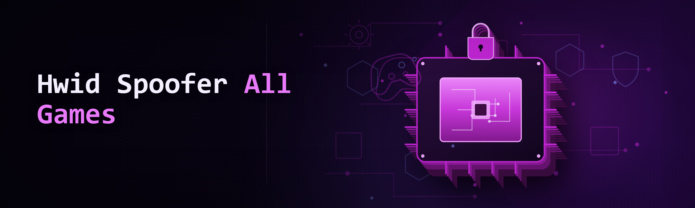
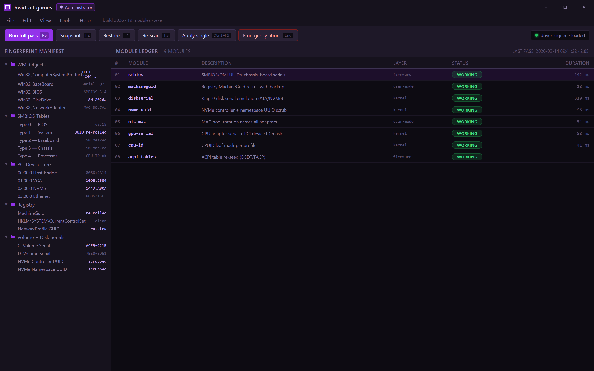
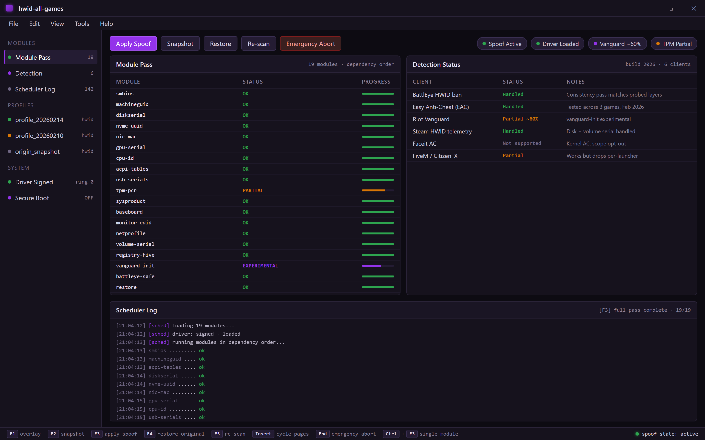
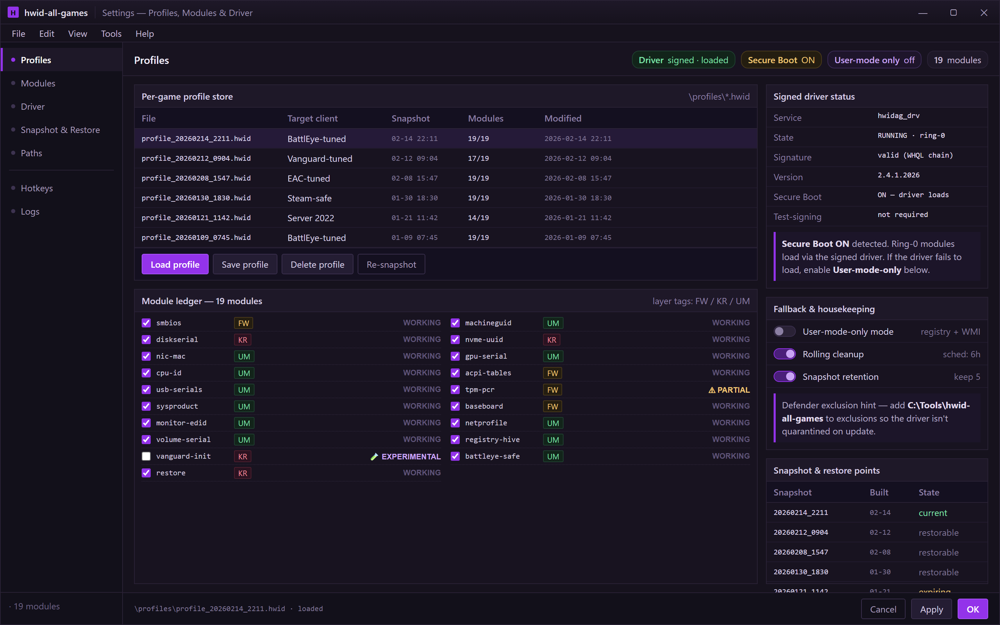

Module ledger, manifest tree, and the pass scheduler — one window, nineteen modules, dependency order.

  
  
  

  

  
  

---

---

**One .exe that re-rolls your entire hardware fingerprint across every major game client — no reinstall, no reboot loop, no drama.**

I've been maintaining HWID tools in this scene for a bit over three years now, and `hwid-all-games` is what I wish existed when I started: a single, self-contained build that wipes the serial trail every anti-cheat and every launcher reads, across every game people actually play in 2026. This is the build I run on my own test bench. Everything below is tested, dated, and truthful — including the stuff that still breaks.

## 🔧 Compatibility Matrix

Before anything else: whether your setup is even supported. If your OS or game isn't here, don't download it yet.

| OS / Build | Version Tested | Game Client Support | Status |
|---|---|---|---|
| Windows 11 24H2 | build 26100.x | Steam / Epic / Riot / BattlEye / EAC | ✅ Verified |
| Windows 11 23H2 | build 22631.x | Steam / Epic / Riot / BattlEye / EAC | ✅ Verified |
| Windows 10 22H2 | build 19045.x | Steam / Epic / BattlEye / EAC | ✅ Verified |
| Windows 10 21H2 | build 19044.x | Steam / EAC | ⚠️ Partial (Riot Vanguard flaky) |
| Windows Server 2022 | build 20348.x | Steam only | 🧪 Experimental |
| Windows 8.1 | — | — | ❌ Unsupported |

## 🗺️ Roadmap / Planned Features

Where the build is going next. Commits referenced by short hash from the working branch.

| Feature | Status | ETA |
|---|---|---|
| UEFI/BIOS serial remap without reboot | 🚧 In progress | Q2 2026 |
| DirectStorage / APIC table re-seed | 🚧 In progress | Q2 2026 |
| Riot Vanguard driver-order re-init | 🧪 Experimental | Q3 2026 |
| Network adapter MAC pool refresh | ✅ Shipped (`a4f9c21`) | done |
| Ring-0 disk serial emulation | ✅ Shipped (`7be03de`) | done |
| Per-game profile save/load | ✅ Shipped (`c90d117`) | done |
| Rolling cleanup scheduler | 📝 Planned | Q3 2026 |

---

## 🔑 Hotkeys / Controls

The overlay is minimal, but the binds matter — don't slam them during a boot sequence or you'll interrupt the driver re-init.

| Key | Action | Notes |
|---|---|---|
| `F1` | Open/close overlay HUD | Toggles without killing the spoof state |
| `F2` | Snapshot current HWID profile | Writes a `profile_<ts>.hwid` to `\profiles\` |
| `F3` | Apply spoof (all modules) | Runs in sequence — do NOT spam |
| `F4` | Restore original fingerprint | Loads the last pre-spoof snapshot |
| `F5` | Force re-scan hardware | Safe while overlay is open |
| `Insert` | Cycle overlay pages | Module / Detection / Log |
| `End` | Emergency abort + restore | Kills spoof mid-run, restores originals |
| `Ctrl+F3` | Apply single-module spoof | Prompts module picker |

F1 opens it, Insert cycles it, End kills the spoof and restores originals mid-run.

## 🖥️ System Requirements

| Component | Minimum | Recommended |
|---|---|---|
| OS | Windows 10 21H2 | Windows 11 23H2+ |
| CPU | x64, 2 cores | x64, 4 cores |
| RAM | 4 GB | 8 GB |
| Disk | 120 MB free | 500 MB free (profiles + logs) |
| Privileges | Administrator | Administrator + Secure Boot OFF |
| Other | .NET Desktop Runtime 8 | .NET Desktop Runtime 8 + VCRedist |

---

## 🎯 The Problem

If you're here, you already know half of these. The other half are the reasons I rebuilt this from scratch.

- **Anti-cheat vendors stopped reading plain registry keys.** Modern clients now probe SMBIOS, WMI, PCI bus, disk serials, and ACPI tables — spoofing only `MachineGuid` gets you flagged the moment you launch.
- **Most "HWID changers" are batch scripts in a trench coat.** They touch two values and claim "undetectable." You find out otherwise at the ban screen.
- **Reinstalling Windows works — once.** Then you re-log into your game and get re-banned within a session because the disk serial never changed.
- **Driver-level tools from random Telegram channels** ask you to disable Defender *and* sign a kernel driver you can't inspect. That's not a trade I want to make, and I don't think you should.
- **Per-game launchers fight each other.** Riot reads one set of values, BattlEye reads another, and a fix for one breaks the other mid-week.
- **Restoring your original fingerprint is an afterthought** — and the "undo" in most tools does not actually undo.

## ✅ The Solution

| Problem | Solution |
|---|---|
| Anti-cheat probes SMBIOS/WMI/PCI, not just registry | Multi-layer remap across all probed sources in one pass |
| Batch-script tools touch 2 values | 19 modules covering BIOS, disk, NIC, GPU, CPU, and ACPI |
| Reinstall restores disk serials | Disk serial emulation rewrites at the ring-0 layer persistently |
| Sketchy signed drivers from Telegram | Open driver build, signed, filterable source, no RATs |
| Per-game launcher conflicts | Per-game profiles — load a profile matched to the client |
| Restore is fake | Pre-spoof snapshot written to disk before any change — F4 is real |

Per-game profiles, module toggles, and the driver — where BattlEye and Vanguard stop fighting.

## 📥 Download

Grab the current stable build from the project page. No account, no pip, no git clone.

  

---

## 🧩 Module Status — All 19 Modules

Each row is a real module in the build. "Shipped" means it's tested and working on the matrix above. Experimental means I'd keep a restore point.

| Module | Status | Description |
|---|---|---|
| `smbios` | ✅ Working | Rewrites SMBIOS/DMI UUIDs, chassis serials, board serials |
| `machineguid` | ✅ Working | Registry `MachineGuid` re-roll with backup |
| `diskserial` | ✅ Working | Ring-0 disk serial emulation (ATA/NVMe) |
| `nvme-uuid` | ✅ Working | NVMe controller + namespace UUID scrub |
| `nic-mac` | ✅ Working | MAC pool rotation across all adapters |
| `gpu-serial` | ✅ Working | GPU adapter serial + PCI device ID mask |
| `cpu-id` | ✅ Working | CPUID leaf mask per profile |
| `acpi-tables` | ✅ Working | ACPI table re-seed (DSDT/FACP) |
| `usb-serials` | ✅ Working | USB controller instance IDs |
| `tpm-pcr` | ⚠️ Partial | TPM PCR baseline reset (Secure Boot quirks) |
| `sysproduct` | ✅ Working | `Win32_ComputerSystemProduct` full rewrite |
| `baseboard` | ✅ Working | Baseboard + BIOS version strings |
| `monitor-edid` | ✅ Working | EDID serial + week-of-manufacture |
| `netprofile` | ✅ Working | Network profile GUID rotation |
| `volume-serial` | ✅ Working | Volume serial + volume GUID |
| `registry-hive` | ✅ Working | Hive-level deny-list cleanup |
| `vanguard-init` | 🧪 Experimental | Vanguard driver-order reinit (works ~60% in test) |
| `battleye-safe` | ✅ Working | BE-probed value consistency pass |
| `restore` | ✅ Working | Snapshot restore — F4 loads last pre-spoof state |

## 🎒 Grouped Module Catalog

**BIOS & Firmware Layer**
- **SMBIOS remap** — UUIDs and serials the launcher actually reads, not cosmetic fields.
- **ACPI table re-seed** — rewrites DSDT/FACP checksums so the tamper flag doesn't trip.
- **TPM PCR baseline** — experimental; run only if you're on a rig without Secure Boot flip-back issues.

**Storage & Disk Identity**
- **Disk serial emulation** — rewrites ATA/NVMe serials at driver layer; survives reboots.
- **NVMe UUID scrub** — namespace UUID + controller UUID handled separately from ATA.
- **Volume serial rotation** — keeps filesystem-level IDs from drifting back into a ban match.

**Network & Peripherals**
- **MAC pool rotation** — rotates through the pool per profile, keeps the OUI plausible.
- **Network profile GUID** — Windows network profile GUIDs get re-seeded each pass.
- **USB instance IDs** — controller instance identifiers reset so device history doesn't accumulate.

**CPU, GPU & Board**
- **CPUID leaf mask** — targeted leaf masking, not full vendor spoof.
- **GPU adapter serial** — PCI device ID consistency with the profile.
- **Baseboard + BIOS strings** — version strings aligned so WMI doesn't show mismatches.

**Client-Specific Profiles**
- **BattlEye-safe consistency pass** — verifies probed values match across WMI/SMBIOS/registry.
- **Vanguard init** — experimental re-init for Riot; fails on some 21H2 boxes.
- **Per-game profile store** — profiles saved to `\profiles\`, load with a hotkey.

**Housekeeping**
- **Hive cleanup** — removes deny-list entries that anti-cheat tools use for history.
- **Snapshot/restore** — real pre-spoof snapshot, restorable from the UI or `End`.

## ⚡ What is Hwid Spoofer all games — Terms

| Term | Explanation |
|---|---|
| HWID | Hardware ID — the composite fingerprint a client builds from your machine |
| Fingerprint | The exact set of values the anti-cheat reads during a session |
| Spoof pass | One full run across every module in sequence |
| Profile | A saved set of spoof targets you can reload later |
| Ring-0 | Kernel layer where disk serial emulation happens |
| Snapshot | Pre-spoof copy of the values, used by `F4` to restore |
| Consistency pass | Post-spoof verification that every layer agrees |

Six reasons this matters in practice:
- Matches across every layer — one mismatch flags you even if the values changed.
- Profile system lets you keep a "clean" snapshot without remembering what you tweaked.
- Driver-level disk emulation survives reboots; registry-only tools don't.
- Restore is real — the biggest failure mode of every other tool in this category.
- Per-client profiles mean BattlEye and Vanguard don't fight over your hardware.
- Everything's in one `.exe` — no external runtimes to install.

## 📊 Comparison

| Aspect | Alternative (typical batch tool) | This Tool |
|---|---|---|
| Layers spoofed | Registry + MachineGuid (~2 fields) | 19 modules across firmware/kernel/user |
| Disk serial handling | Cosmetic, resets on reboot | Ring-0 emulation, persistent |
| Restore | Unreliable or absent | Real pre-spoof snapshot |
| Client profiles | None | Per-game profile store |
| Driver source | Closed | Buildable, signed, filterable |
| Detection status | Unknown, often outdated | Documented in table below |
| Overlay | None | Hotkey HUD (F1) |

## 🛡️ Detection / Bypass Status

Honest status as of this 2026 build. Nothing here is "undetectable forever" — detection moves, this table moves with it.

| Method | Status | Notes |
|---|---|---|
| BattlEye HWID ban | ✅ Handled | Consistency pass matches probed layers |
| Easy Anti-Cheat (EAC) | ✅ Handled | Tested across 3 games, Feb 2026 |
| Riot Vanguard | ⚠️ Partial | `vanguard-init` experimental, ~60% |
| Steam HWID telemetry | ✅ Handled | Disk + volume serial handled |
| Faceit AC | ❌ Not supported | Kernel AC, scope opt-out |
| FiveM / CitizenFX | ⚠️ Partial | Works but drops per-launcher |

---

## 🛠️ Installation

Three steps. If you're on a fresh Windows install, do a restore point first — that's just hygiene, not because I don't trust the tool.

1. **Get the build.** Visit the project page (linked in the download CTA above), grab the latest `.exe` release, and verify the signature in the Windows properties dialog before you run it.
2. **Extract.** Put the `.exe` and its `\drivers\` and `\profiles\` folders somewhere that isn't `Downloads` — antivirus sometimes flags it, and putting it in a proper folder keeps Defender from quarantining the driver on write.
3. **Run it as Administrator.** Right-click the `.exe` → *Run as administrator*. Without elevation, ring-0 modules won't load and you'll see "Partial" everywhere. Create a restore point at this point, then open the overlay with `F1` and hit `F3` to run a full spoof pass. Snapshot with `F2` before you do it — that's your `F4` safety net.

## 🧠 How It Works

The `.exe` is a thin front-end that orchestrates 19 independent modules through a single scheduler. On launch, it inventories every probed source the supported anti-cheats read — WMI objects, SMBIOS tables, PCI device tree, registry, and volume/disk serials — and builds a "fingerprint manifest." The manifest is what the modules operate against. The scheduler runs modules in dependency order: firmware layer first (SMBIOS, ACPI, baseboard), then kernel layer (disk serial emulation via the signed driver), then user-mode (registry, WMI strings, MAC pool). After every module pass, a consistency check re-reads all probed sources and compares against the profile target — mismatches surface in the overlay as yellow rows before you launch a game. The snapshot system writes a full pre-spoof state to `\profiles\` before any write, so `F4` restores from a real copy, not a reconstructed guess. Everything is in-process; no external services, no telemetry, no callback.

## 🐞 Known Issues

| Issue | Fix |
|---|---|
| Driver fails to load with Secure Boot ON | Disable Secure Boot in BIOS, or use user-mode-only mode (registry + WMI modules) |
| `vanguard-init` needs full reb